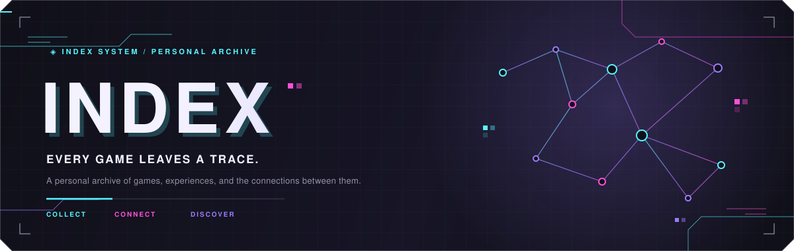

 

 

<a href="#overview">OVERVIEW</a>　/　
<a href="#features">FEATURES</a>　/　
<a href="#visual-identity">DESIGN</a>　/　
<a href="#roadmap">ROADMAP</a>

---

### ◈ ARCHIVE THE EXPERIENCE.
### ⌘ DISCOVER THE CONNECTIONS.

*A personal game archive with an arcade soul.*

## 01 &nbsp; OVERVIEW

**Index is a personal archive for the games that leave a mark.**

Not just what you played, but what stayed with you.

The late-night obsessions. The difficult milestones. The strange little games you stumbled across and never quite forgot. The experiences that seem unrelated until you look at them from a different angle.

Index brings those experiences together in a searchable catalogue and an interactive constellation of game-to-game relationships.

<table align="center">
<tr>
<td width="50%" valign="top">

<h3> ◈ THE ARCHIVE</h3>

A structured home for your gaming history.

- Game records and artwork
- Ratings, dates, and playtime
- Personal notes and reflections
- Multi-dimensional tagging
- Search, sorting, and filtering

</td>
<td width="50%" valign="top">

<h3>⌘ THE CONSTELLATION</h3>

A collection that becomes a landscape.

- Circular game-art nodes
- Calculated similarity scores
- Spatial clusters of related games
- Interactive connections
- Discovery beyond a conventional list

</td>
</tr>
</table>

ONE COLLECTION.  
MANY CONNECTIONS.

## 02 &nbsp; FEATURES

> [!NOTE]
> Index is a work in progress. The features below describe the intended direction; they are not claims of completed functionality.

<table>
<tr>
<td width="42">
◈
</td>
<td>

**01 — Game Archive**

A searchable library with compact list and artwork-rich gallery views.

</td>
</tr>
<tr>
<td>
◎
</td>
<td>

**02 — Game Files**

Individual records for ratings, play history, personal commentary, and tags.

</td>
</tr>
<tr>
<td>
⌘
</td>
<td>

**03 — Constellation**

An interactive spatial map of games connected through shared attributes.

</td>
</tr>
<tr>
<td>
▦
</td>
<td>

**04 — Tag Atlas**

A way to explore recurring themes, mechanics, moods, and patterns across the collection.

</td>
</tr>
<tr>
<td>
◷
</td>
<td>

**05 — Playback**

A timeline of gaming experiences, revisits, phases, and changing interests.

</td>
</tr>
</table>

## 03 &nbsp; VISUAL IDENTITY

**DIGITAL ARCADE × CYBERNETIC PRECISION**

Deep-space darkness. Electric colour. Sharp geometry. A system that feels like it has been customized far beyond its original purpose.

### The palette

<table>
  <tr>
    <td align="center" width="25%">
      
       <strong>ARCADE VOID</strong>
       <code>#101019</code>
    </td>
    <td align="center" width="25%">
      
       <strong>CABINET</strong>
       <code>#1B1B2B</code>
    </td>
    <td align="center" width="25%">
      
       <strong>ELECTRIC CYAN</strong>
       <code>#55F6FF</code>
    </td>
    <td align="center" width="25%">
      
       <strong>GLITCH MAGENTA</strong>
       <code>#FF4FD8</code>
    </td>
  </tr>
  <tr>
    <td align="center" width="25%">
      
       <strong>DIGITAL VIOLET</strong>
       <code>#9B7CFF</code>
    </td>
    <td align="center" width="25%">
      
       <strong>SIGNAL WHITE</strong>
       <code>#F4F2FF</code>
    </td>
    <td align="center" width="25%">
      
       <strong>STATIC SILVER</strong>
       <code>#9292A8</code>
    </td>
    <td align="center" width="25%">
      
       <strong>DEEP CABINET</strong>
       <code>#151522</code>
    </td>
  </tr>
</table>

### The rules of the machine

- **CYAN** signals interaction, focus, and active connections.
- **MAGENTA** provides contrast, emphasis, and occasional disruption.
- **VIOLET** evokes discovery, clusters, and the unknown.
- **METAL & GLASS** define the interface through fine borders, layered surfaces, and clipped corners.
- **PIXELS & TRACES** appear as deliberate details, not visual noise.

The inspiration is cybernetic arcade design: sharp, expressive, and technically precise, without reproducing any existing character or interface.

## 04 &nbsp; ROADMAP

01 FOUNDATION　→　
02 ARCHIVE　→　
03 CONSTELLATION　→　
04 EXPANSION

- [ ] **Foundation** — Data model, project structure, and design system.
- [ ] **Archive** — Searchable catalogue, filters, and game files.
- [ ] **Constellation** — Similarity calculations, spatial layout, and interactive exploration.
- [ ] **Expansion** — Tag Atlas, Playback timeline, and quality-of-life improvements.

The priority is to make each layer feel complete before adding the next. The constellation is the signature; the archive is the foundation.

## 05 &nbsp; PHILOSOPHY

### A SMALL CORNER OF THE INTERNET, BUILT FOR CURIOSITY.

Index is a hobby project, personal by design.

No engagement loops. No monetization strategy. No pressure to turn an interesting idea into a business.

Just a collection worth keeping, a distinctive interface worth building, and connections worth discovering.

The project can grow without losing the reason it exists.

---

 

◈ **INDEX** / **END OF RECORD**

PERSONAL ARCHIVE · DIGITAL ARCADE · WORK IN PROGRESS

